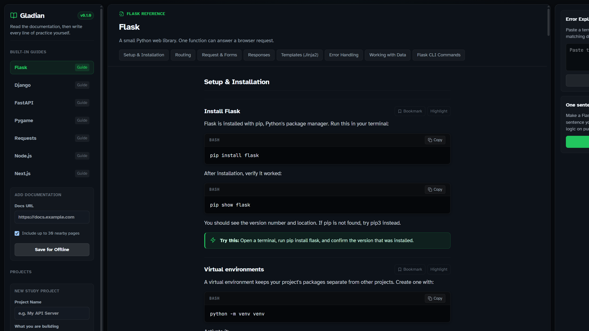

# Gladian

An offline desk for reading programming documentation and practicing one small piece of it yourself. The app does not write the practice file for you.



## Try it

- Web, no install: https://evinjsubin.github.io/Gladian/
- Windows app: https://github.com/EVINJSUBIN/Gladian/releases/tag/v0.1.0 (`Gladian.exe`, or the zip next to it)

The web demo is the review copy. Open Flask, scroll the modules, bookmark a section, then paste this into **Error Explainer**:

```
404 Not Found: The requested URL was not found on the server.
```

It should name the matching section in the guide. That match is local. It does not call a server.

## What is in the box

Built-in guides, readable with the network off:

- Flask
- Django
- FastAPI
- Pygame
- Requests
- Node.js
- Next.js

Each guide is split into modules. A section can be bookmarked or highlighted. Those marks stay in the browser. Each library also has one practice file. You write it. Gladian checks for the constructs the exercise asked for. It does not fill in the solution.

On the desktop app (`npm run dev`, or the `.exe`):

- Paste a docs URL and save up to 30 pages from that same path as text.
- Store an Anthropic key on this computer. The key is not sent back to the page.
- Ask for a study plan that points at the local guides, or a short reading note on a folder you pick. The note does not edit the folder.
- Optionally turn a saved URL into a shorter module list. The built-in guides already work without that.

The web demo can read, bookmark, highlight, explain errors, and open the practice editor. Saving a project, importing a URL, and the AI calls need the desktop window.

## Run it from source

Node.js 20 or newer. Rust is only needed for the Tauri window.

```bash
git clone https://github.com/EVINJSUBIN/Gladian.git
cd Gladian
npm install
npm run dev:web
```

Other commands:

- `npm run dev` — Tauri window
- `npm run dev:electron` — Electron window
- `npm run build:web` — static site in `dist/`
- `npm run build` — native installer
- `npm run typecheck`

## Layout

`src/renderer` is the desk. `src/renderer/src/docs` holds the built-in guides. `src-tauri` saves imported pages, runs the single practice file, and makes the optional model call. `src/main` is the Electron shell. `packs/` has three small project guides that are not the home screen.

## AI

A model is optional. The guides, bookmarks, highlights, error lookup, and practice check work with no key. When a key is saved in the desktop app, one call can draft a plan or a reading note. The prompt asks for steps and a note, not a finished program, and the app does not apply a patch to your folder.

I used coding tools while building Gladian. The desk, the guide text, and the offline error matching are in this repo for a reviewer to read.

## License

MIT. Copyright 2026 Evin Jacob Subin. See [LICENSE](LICENSE).
